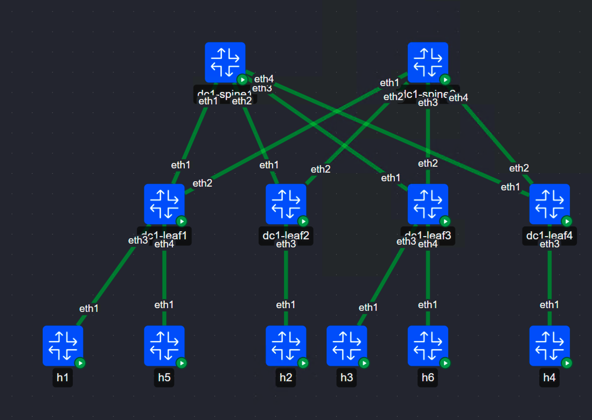

# lab-dc1-clos-evpn-a

3-stage Clos, single site, all Arista cEOS. eBGP IPv4 underlay with per-node
ASNs, eBGP EVPN full-mesh overlay between the leaves, VXLAN dataplane on the
leaf tier, symmetric IRB through a single L3VNI.

Difficulty: **architect**. Faults: **6**. Domains: BGP (primary), EVPN/VXLAN, TE.

---

## Pre-flight

Host tunables. cEOS fails on Ubuntu defaults once you get past a handful of nodes:

```
sudo sysctl -w fs.inotify.max_user_instances=2048
sudo sysctl -w fs.inotify.max_user_watches=1048576
sudo sysctl -w net.ipv4.ip_forward=1
```

No KVM, no nested virtualisation, no vrnetlab. Every node in this lab is a
native container.

## Deploy

```
containerlab deploy -t dc1-clos-evpn-a.clab.yml
# wait ~60s for all six cEOS nodes to finish agent startup, then:
bash faults/inject.sh
```

Boot expectation: all twelve nodes ready in roughly 60 to 90 seconds. Underlay
BGP settles within another 30 seconds. Do not start troubleshooting until
`show ip bgp summary` on both spines shows 4 peers Established, otherwise you
will chase a boot race instead of a fault.

Footprint: ~12.5 GB RAM, ~7 vCPU (6x cEOS at 2 GB / 1 vCPU, 6x endpoints at
~50 MB). Re-arm cycles are cheap on this build: `faults/restore.sh` then
`faults/inject.sh` takes under a minute, no reboot.

| Node | Tier | Image |
|---|---|---|
| dc1-spine1, dc1-spine2 | 1 | ceos:4.36.0.1F |
| dc1-leaf1..leaf4 | 1 | ceos:4.36.0.1F |
| h1..h6 | 1 | wbitt/network-multitool:alpine-extra |

---

## Topology



Endpoint addressing (all /24, host MTU 9000):

| Host | Leaf | Port | VLAN | Address |
|---|---|---|---|---|
| h1 | leaf1 | Et3 | 10 | 172.16.10.11 |
| h5 | leaf1 | Et4 | 20 | 172.16.20.11 |
| h2 | leaf2 | Et3 | 10 | 172.16.10.12 |
| h3 | leaf3 | Et3 | 20 | 172.16.20.13 |
| h6 | leaf3 | Et4 | 10 | 172.16.10.13 |
| h4 | leaf4 | Et3 | 20 | 172.16.20.14 |

## Underlay addressing

| Link | Spine side | Leaf side |
|---|---|---|
| spine1 Et1 – leaf1 Et1 | 10.1.0.0/31 | 10.1.0.1/31 |
| spine1 Et2 – leaf2 Et1 | 10.1.0.2/31 | 10.1.0.3/31 |
| spine1 Et3 – leaf3 Et1 | 10.1.0.4/31 | 10.1.0.5/31 |
| spine1 Et4 – leaf4 Et1 | 10.1.0.6/31 | 10.1.0.7/31 |
| spine2 Et1 – leaf1 Et2 | 10.1.1.0/31 | 10.1.1.1/31 |
| spine2 Et2 – leaf2 Et2 | 10.1.1.2/31 | 10.1.1.3/31 |
| spine2 Et3 – leaf3 Et2 | 10.1.1.4/31 | 10.1.1.5/31 |
| spine2 Et4 – leaf4 Et2 | 10.1.1.6/31 | 10.1.1.7/31 |

Loopback0 doubles as router-id, overlay peering source, and VTEP source on every
leaf: 10.0.0.1 / .2 / .3 / .4. Spines: 10.0.0.101, 10.0.0.102.

ASNs: spine1 65001, spine2 65002, leaf1 65101, leaf2 65102, leaf3 65103,
leaf4 65104. The two spines sit in **different** ASNs, which is why every leaf
carries `bgp bestpath as-path multipath-relax` for underlay ECMP.

Fabric MTU is 9214 on every routed fabric interface and every SVI. Endpoints run
9000. VXLAN adds 50 bytes of outer encapsulation, so a 9000-byte tenant frame
needs ~9050 bytes of underlay MTU end to end.

## Tenant plan

| Object | Value |
|---|---|
| VRF | TENANT-A |
| VLAN 10 | VNI 10010, 172.16.10.0/24, anycast GW 172.16.10.1 |
| VLAN 20 | VNI 10020, 172.16.20.0/24, anycast GW 172.16.20.1 |
| L3VNI | 50001, RT 9000:50001 |
| MAC-VRF RT | 9000:10010 (VLAN 10), 9000:10020 (VLAN 20), import = export |
| RD | `<Loopback0>:<VNI>` per leaf |
| Anycast GW MAC | 00:1c:73:ba:be:01, identical on all four leaves |
| External prefix | 192.168.200.0/24, originated by leaf1 and leaf2 |

## Design intent

Single-site 3-stage Clos carrying one tenant across four leaves, with symmetric
IRB through L3VNI 50001. The underlay is eBGP with per-node ASNs and ECMP across
both spines. The overlay is an eBGP EVPN full mesh between the four leaves, so
the spines are pure IP transit and hold no EVPN state at all. leaf1 and leaf2 are
the border pair for the external prefix 192.168.200.0/24: **leaf2 is the primary
exit**, tagged 65000:200 on origination, and every other leaf raises
local-preference to 200 on that community; leaf1 carries 65000:50 and is the
standby. One leaf uplink is currently drained in the control plane for a
scheduled optics replacement, so an asymmetry in underlay path selection for
that node is expected and correct.

## Reported symptoms - Fault set #1

> Overnight change window closed at 01:40. Since then:
>
> - App team says VLAN 10 hosts on leaf1 and leaf2 "sometimes" can't see each
>   other. Ping works when they test it, file copies hang.
> - VLAN 20 users on leaf3 report the app on leaf4 is completely dead. Not
>   intermittent. Dead.
> - Someone on leaf2 says everything is fine from their side and we're wasting
>   their time.
> - Security opened a ticket: outbound sessions to 192.168.200.0/24 are hitting
>   the standby firewall for some users and the state table is rejecting them.
> - Link utilisation graphs on the leaf2 uplinks look "lopsided" since the
>   window but nobody has looked closely.
>
> Nothing was supposed to change last night except a routine policy cleanup.

## Rules of engagement

- Do not open `ANSWERS.md`.
- Do not `diff` `configs/` against running config. That's the cheat path and it teaches nothing.
- Do not read `faults/`.
- Fix faults on the device, via the device CLI. Not by editing files and redeploying.
- Log your time-to-detect per fault. That number is the actual score.
